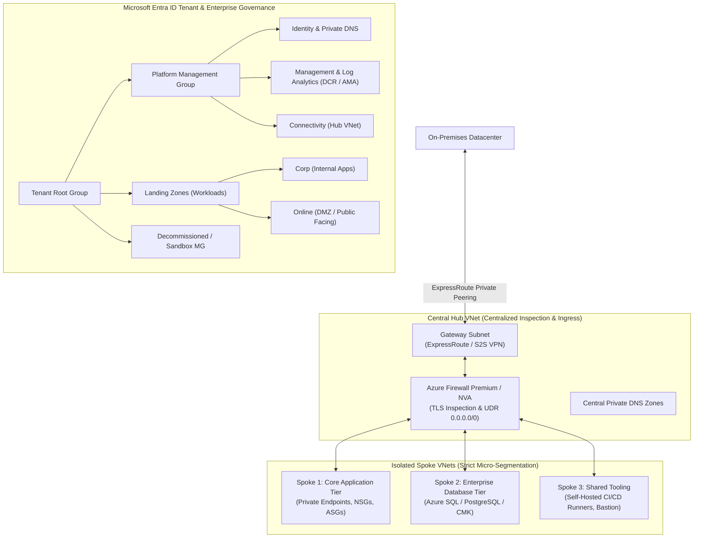

<div align="center">

  <!-- Header Banner -->
  

  <!-- Dynamic Typing SVG Subtitle -->
  <a href="https://github.com/satyendrasingh2006">
    
  </a>

  <br/>

  <!-- Quick Badges -->
  <p align="center">
    <a href="https://linkedin.com/in/satyendra-singh"></a>
    <a href="mailto:satyendrasingh2006Sep26@b18g1.online"></a>
    
    
    
  </p>

</div>

---

### 👨‍💻 Executive Summary & Professional Profile

> *"Architecture is not just about drawing boxes and pipelines; it is about aligning technical infrastructure with business revenue, guaranteeing uncompromising security, eliminating operational waste, and leveraging cutting-edge Agentic AI to scale fearlessly."*

I am a **Staff / Principal Cloud Architect & Lead DevSecOps Engineer** with **10+ years of hands-on and strategic enterprise experience**. Throughout my career, I have owned the end-to-end technology lifecycle across Fortune 500 environments and high-growth systems—from multi-datacenter on-premises migrations to large-scale **Azure & Multi-Cloud Landing Zones**, automated **Zero-Trust DevSecOps pipelines**, and **FinOps cloud financial governance**.

Today, as software engineering enters the AI era, I spearhead the convergence of **DevSecOps and Agentic AI**: integrating **Model Context Protocol (MCP)** servers, **Enterprise RAG (Retrieval-Augmented Generation)** copilots for incident triage, and **Autonomous AI Agents** for automated infrastructure drift healing and security vulnerability remediation.

---

### 🏆 Enterprise Track Record & Scale

<div align="center">

| Metric | Enterprise Scale Achieved | Core Business Impact |
| :---: | :---: | :--- |
| **Experience** | **10+ Years** | Technical Lead, Enterprise Architect & Advisory across complex domains |
| **Migrations** | **100+ Enterprise Workloads** | Seamless On-Prem to Azure migration with zero business downtime |
| **Cost Optimization** | **28% - 35% Spend Reduction** | Enterprise FinOps: Rightsizing, RIs, Savings Plans & DCR log tuning |
| **Pipeline Governance** | **100% Shift-Left Security** | Checkov, Trivy, GitLeaks, Infracost & automated branch policies |
| **Availability Posture** | **99.99% Multi-Region HA** | VMSS across Availability Zones, ASR DR, and tight RTO (<15m) / RPO (<5m) |
| **Next-Gen AI Ops** | **MCP & RAG Integration** | Autonomous incident diagnosis, runbook search & self-healing IaC |

</div>

---

### 🤖 Next-Gen AI & Modern DevSecOps: Where Infrastructure Meets Intelligence

In modern enterprise engineering, **AI is not a buzzword—it is the operational backbone**. I architect and implement practical, production-ready AI paradigms directly into the DevSecOps lifecycle:

```
+---------------------------------------------------------------------------------------------------------+
|                                    NEXT-GEN AGENTIC AI & DEVOPS ECOSYSTEM                              |
+---------------------------------------------------------------------------------------------------------+
|                                                                                                         |
|  +---------------------------+     +-------------------------------+     +---------------------------+  |
|  |   Model Context Protocol  |     |   Enterprise RAG Runbooks     |     |   Autonomous AI Agents    |  |
|  |          (MCP)            |     |        (Vector Search)        |     |      (Self-Healing Ops)   |  |
|  +---------------------------+     +-------------------------------+     +---------------------------+  |
|  | Standardized protocol to  |     | Ingests 10+ yrs of runbooks,  |     | Detects Terraform state   |  |
|  | safely expose Azure APIs, |     | post-mortems & SOPs into      |     | drift and opens automated |  |
|  | Kubernetes state & logs   |     | Qdrant/pgvector for sub-      |     | PRs with Checkov & Trivy  |  |
|  | to AI Agents as tools.    |     | second incident diagnosis.    |     | validation pre-tested.    |  |
|  +---------------------------+     +-------------------------------+     +---------------------------+  |
|                                                                                                         |
+---------------------------------------------------------------------------------------------------------+
```

* **Model Context Protocol (MCP):** Implementing custom MCP servers that allow LLMs to safely query cloud telemetry, inspect Kubernetes pod health, and parse Terraform state plans with strict read-only / least-privilege boundary controls.
* **Enterprise RAG (Retrieval-Augmented Generation):** Transforming disparate engineering documentation, Architectural Decision Records (ADRs), and legacy post-mortems into vectorized semantic knowledge bases for instant, citation-backed on-call troubleshooting.
* **Autonomous DevOps Agents:** Deploying proactive agents for FinOps waste-hunting (orphaned disks, idle IP addresses), automated dependency CVE patching, and continuous compliance checks.

---

### 🏗️ Enterprise Architecture Blueprints

#### 1. Enterprise Hub-and-Spoke & Cloud Adoption Framework (CAF) Landing Zone



---

#### 2. Shift-Left DevSecOps Pipeline with Agentic AI Co-Pilot

```mermaid
flowchart LR
    subgraph GitOps["1. GitOps & Code Assurance"]
        Code["Developer Branch"] --> PR["PR to Main\n(Branch Policies & CODEOWNERS)"]
        PR --> Lint["Lint & Syntax\n(terraform fmt / tflint)"]
        Lint --> SecScan["Security Scan\n(Checkov | Trivy | GitLeaks)"]
        SecScan --> Cost["Cost Estimator\n(Infracost Delta)"]
    end

    subgraph Deployment["2. Guarded Cloud Deployment"]
        Cost --> Plan["Terraform Plan &\nBlob Lease State Lock"]
        Plan --> Approval{"Peer & Architect\nApproval Gate"}
        Approval -->|Approved| Apply["Terraform Apply &\nZero-Downtime Rolling Update"]
    end

    subgraph AIAgentic["3. Autonomous Agentic Ops (MCP + RAG)"]
        Apply --> Telemetry["Azure Monitor & AMA Telemetry"]
        Telemetry --> Drift["Scheduled Drift Detection Pipeline"]
        Drift --> Agent["Autonomous DevOps Agent"]
        Agent <-->|Tool Execution| MCPServer["MCP Server (Cloud APIs & K8s State)"]
        Agent <-->|Context Search| RAGStore["RAG Runbook Engine (Vector DB)"]
        Agent -->|Auto Remediation| AutoPR["Auto-Generated Fix PR & Alert Notification"]
    end
```



---

### 🛠️ Technical Arsenal & Core Stack

<div align="center">

| Domain | Technologies & Frameworks |
| :--- | :--- |
| **Cloud & Hyperscalers** |    |
| **Infrastructure as Code & GitOps** |      |
| **DevSecOps & CI/CD Pipelines** |       |
| **Containers & Orchestration** | -326CE5?style=flat-square&logo=kubernetes&logoColor=white)    |
| **Next-Gen AI & Agentic Ops** | -8A2BE2?style=flat-square&logo=openai&logoColor=white)    |
| **Security, Identity & Governance** | -0078D4?style=flat-square&logo=microsoft&logoColor=white)    |
| **Observability, FinOps & SRE** |  -00B4B6?style=flat-square&logo=infracost&logoColor=white)    |
| **Languages & Scripting** |     |

</div>

<br/>

<div align="center">
  
</div>

---

### 🏛️ The Enterprise Architecture & Leadership Framework

Click to expand detailed real-world architectural strategies based on 10+ years of enterprise execution:

<details>
<summary><b>📖 01. Enterprise Governance, Management Hierarchy & Cloud Adoption Framework (CAF)</b></summary>
<br>

* **Cloud Adoption Framework (CAF) Implementation:** Six-phase execution encompassing *Strategy* (business justification & ROI), *Plan* (workload prioritization & skillset alignment), *Ready* (landing zone rollout), *Adopt* (migration & modernization sprints), *Govern* (Azure Policy guardrails), and *Secure/Manage* (continuous telemetry & threat modeling).
* **Management Group Hierarchy:**
  * **Tenant Root Group:** Baseline corporate compliance policies.
  * **Platform Management Group:** Decoupled into `Identity` (Entra ID, Domain Services, DNS), `Management` (centralized Log Analytics Workspace, DCR, backup vaults), and `Connectivity` (Hub VNet, Firewalls, ExpressRoute).
  * **Landing Zones (Workloads):** Sub-divided into `Corp` (internal-only traffic) and `Online` (public/DMZ ingress) across isolated `Dev`, `UAT`, and `Prod` subscriptions to prevent noisy neighbors and isolate blast radiuses.
  * **Sandboxes & Decommissioned:** Strictly segregated environments with zero access to corporate routes.
* **RBAC & PIM Governance:** Zero standing admin privileges. Enforced **Microsoft Entra Privileged Identity Management (PIM)** with multi-stage approval workflows, time-bound access (max 4 hours), and mandatory MFA.
* **Automated Policy Initiatives:** Enforced built-in initiatives (CIS Microsoft Azure Foundations Benchmark, Microsoft Cloud Security Benchmark - MCSB) applied at the Management Group scope with `Deny` and `Modify` effects.

</details>

<details>
<summary><b>🌐 02. Enterprise Hub-and-Spoke Networking & Micro-Segmentation</b></summary>
<br>

* **IPAM & CIDR Allocation:** Rigorous pre-migration assessment of on-premises subnets to guarantee non-overlapping IP spaces across multi-region Azure VNets.
* **Central Traffic Inspection:** User Defined Routes (UDRs) forcing all outbound internet (`0.0.0.0/0`) and spoke-to-spoke lateral traffic through an **Azure Firewall Premium / NVA cluster** with deep TLS inspection, URL filtering, and IDPS (Intrusion Detection & Prevention System).
* **Private Connectivity Standard:** Complete deprecation of public PaaS endpoints. All Azure SQL, Key Vault, Storage Accounts, and AKS APIs are accessible exclusively via **Private Endpoints (Private Link)** linked to centralized Private DNS Zones in the Hub.
* **Hybrid Ingress / Egress:** Dual ExpressRoute circuits with automated VPN failover; public inbound traffic managed through Azure Front Door / Application Gateway with Web Application Firewall (WAF) OWASP Top 10 rule enforcement.

</details>

<details>
<summary><b>🔒 03. Multi-Layered Defense-in-Depth Security Matrix</b></summary>
<br>

| Security Dimension | Enterprise Controls & Tooling Implemented |
| :--- | :--- |
| **Identity & Access** | Microsoft Entra ID, Conditional Access policies, FIDO2/MFA, Just-In-Time (JIT) via PIM, Workload Managed Identities. |
| **Network Security** | Micro-segmentation with NSGs/ASGs, Azure Firewall Premium with TLS inspection, DDoS Protection Standard, Private Link. |
| **Application & Code** | GitLeaks secrets prevention, Checkov IaC security scanning, Trivy container CVE scans, SonarQube SAST gates. |
| **Compute & Host** | Microsoft Defender for Cloud, automatic agent baselining via VM custom data/Cloud-Init, Customer-Managed Keys (CMK) disk encryption. |
| **Data & Secrets** | Azure Key Vault with automated rotation, HSM-backed keys, TLS 1.3 in-transit, Azure Storage advanced threat detection. |

</details>

<details>
<summary><b>⚙️ 04. Terraform Landing Zone Automation & Shift-Left GitOps</b></summary>
<br>

* **Modular Architecture:** Self-contained, enterprise-tested Terraform modules maintained with strict Semantic Versioning (`v1.2.0`), tested against linting (`tflint`) and validation (`terraform validate`).
* **Secure Remote State Backend:** Encrypted Azure Blob Storage backend utilizing Blob Lease locks to prevent concurrent runs, restricted via Azure Managed Identities (zero long-lived credentials stored in pipelines).
* **Automated CI/CD Validation Pipeline:**
  1. `terraform fmt -check` & `tflint`
  2. `gitleaks detect` (hard secret prevention)
  3. `checkov -d .` & `trivy config .` (block high/critical IaC misconfigurations)
  4. `infracost breakdown --path .` (predictive monthly cost delta posted directly to PR comments)
  5. `terraform plan -out=tfplan` (signed artifact publication)
  6. **Manual Approval Gate** (PR requires minimum 2 senior peer approvals + CODEOWNERS validation)
  7. `terraform apply tfplan` (executed in isolated deployment runner)
* **Automated Drift Detection:** Scheduled nightly pipelines executing `terraform plan -detailed-exitcode` to catch out-of-band portal changes instantly and trigger alerts.

</details>

<details>
<summary><b>🤖 05. Next-Gen Agentic DevSecOps (MCP, RAG & Autonomous Remediation)</b></summary>
<br>

* **Model Context Protocol (MCP) in Infrastructure:** Developed custom MCP servers that provide LLM agents with standardized, fine-grained access to infrastructure tools (querying Azure Resource Graph, fetching AKS deployment status, inspecting CloudWatch/Azure Monitor metrics) without exposing root credentials.
* **Enterprise RAG Copilot for Platform SRE:**
  * Embedded internal runbooks, incident post-mortems, and compliance policies into a vector database (Qdrant/pgvector).
  * On-call engineers use natural language to query incidents: *"How do we failover the payment database cluster during ExpressRoute latency spikes?"* -> Returns exact step-by-step SOP with verified code snippets and CLI commands.
* **Autonomous Remediation Agents:**
  * **Drift Healing Agent:** Analyzes nightly drift alerts, correlates against recent changes, and generates an automated Pull Request with the required Terraform adjustments.
  * **Security Remediation Agent:** Ingests Trivy/Checkov vulnerability scans, identifies vulnerable base images or outdated Terraform module versions, and automatically submits tested PRs with changelog summaries.

</details>

<details>
<summary><b>📦 06. End-to-End 100+ Enterprise Workload Cloud Migration Playbook</b></summary>
<br>

```
[ Phase 1: Discovery ]  ==>  [ Phase 2: Assessment ]  ==>  [ Phase 3: Landing Zone ]  ==>  [ Phase 4: Cutover ]  ==>  [ Phase 5: Hypercare ]
Inventory, Port & Host       TCO/ROI Modeling, Cloud       Network, Identity &            Low-Downtime Replication,   24/7 Dedicated War Room,
Dependency Mapping           Readiness, 6 R's Strategy     Security Baseline Ready        DNS TTL Shift, Validation   Telemetry Baseline (2-4 Wks)
```

* **Phase 1: Discovery & Dependency Mapping:** Automated discovery with Azure Migrate / agentless appliances to map inter-application dependencies, network traffic flows, and storage IOPs baselines across 100+ workloads.
* **Phase 2: Assessment & 6 R's Decision Matrix:** Categorized every workload: *Rehost* (lift & shift via Azure Site Recovery), *Replatform* (migrating SQL VMs to Azure SQL Managed Instance), *Refactor* (containerizing legacy apps to AKS), *Retire*, *Retain*, or *Repurchase*.
* **Phase 3: Landing Zone Readiness:** Validation of network throughput, ExpressRoute failover tests, RBAC assignments, and target subscription quota verifications prior to migration waves.
* **Phase 4: Cutover Execution:** Orchestrated low-downtime maintenance windows: continuous data replication sync, database log shipping, DNS TTL reduction to 60 seconds, cutover execution, and comprehensive functional sanity testing.
* **Phase 5: Hypercare Support:** 24/7 War Room monitoring for 2 to 4 weeks post-cutover to benchmark application performance, tune resource allocations, and ensure business SLA satisfaction.

</details>

<details>
<summary><b>💰 07. Enterprise FinOps (Cloud Financial Management & Cost Engineering)</b></summary>
<br>

* **Waste Elimination Automation:** Automated serverless routines detecting and terminating unattached managed disks, orphaned snapshots, idle public IPs, and unused ExpressRoute gateways (saving an average of $20K+/month across large estates).
* **Utilization Rightsizing:** 30-day continuous CPU/RAM percentile monitoring to downscale over-provisioned virtual machines and PaaS compute tiers without risking peak SLA headroom.
* **Commitment Governance:** Strategic portfolio management using **Azure Reservations (1-year and 3-year RIs)** and **Azure Savings Plans** for predictable baseline workloads, delivering up to 60% compute cost savings.
* **Log Ingestion Optimization:** Audited high-volume Azure Monitor Log Analytics tables; implemented **Data Collection Rules (DCR)** to filter verbose debug traces at the source, slashing telemetry ingestion bills by 35%.
* **Shift-Left Cost Visibility:** Integrated Infracost into GitHub Actions / Azure DevOps to comment estimated monthly cost deltas directly on every pull request before merging.

</details>

<details>
<summary><b>🛡️ 08. High Availability, Disaster Recovery & RTO/RPO SLAs</b></summary>
<br>

* **Storage Redundancy Architecture:**
  * **LRS:** High-performance, non-critical cache and ephemeral datasets.
  * **ZRS:** Mission-critical databases and transactional state stored synchronously across 3 Availability Zones within a region.
  * **GRS:** Asynchronous replication to a secondary paired Azure region for catastrophic disaster recovery.
* **Compute High Availability:** Deployed workloads across **Virtual Machine Scale Sets (VMSS)** with flexible orchestration spanning multiple Availability Zones and automated horizontal autoscale triggers.
* **Disaster Recovery Posture:**
  * **RTO (Recovery Time Objective):** < 15 minutes automated application failover via Azure Traffic Manager / Front Door health probes.
  * **RPO (Recovery Point Objective):** < 5 minutes data loss guaranteed via continuous database replication and geo-replicated snapshots.
* **Annual DR Drills:** Scheduled end-to-end chaos engineering tests and live regional failover drills to validate runbook accuracy.

</details>

<details>
<summary><b>🤝 09. Executive Leadership, Pre-Sales & Delivery Governance</b></summary>
<br>

* **IT Career Tracks & Senior Mindset:** Experienced across the full IT role spectrum:
  * **Pre-Sales & Proposals:** Led techno-functional proposals, RFI/RFP architectural estimations, high-level design (HLD) presentations, and commercial proof-of-concept (POC) deliveries.
  * **Technical Account Management (TAM):** Acted as trusted enterprise advisor, leading operational governance, escalations, and executive quarterly business reviews (QBRs).
  * **Enterprise Architect & Tech Lead:** Bridging application system design (microservices, event-driven, API gateways) with infrastructure landing zones.
* **Vendor & SOW Management:**
  * Drafting and negotiating precise **Statements of Work (SOW)** with clear deliverables, acceptance criteria, milestone payment schedules, and warranty clauses.
  * Establishing **Technical Evaluation Matrices** to objectively score vendors across security, architecture compliance, support SLAs, and cost.
* **RACI Matrix & Escalation Governance:**
  * Enforcing clear **RACI** (Responsible, Accountable, Consulted, Informed) matrices across cross-functional engineering teams.
  * Implementing structured escalation protocols with defined 15-minute, 1-hour, and 4-hour SLA triggers for production incidents.
* **Team Mentorship & Knowledge Transfer (KT):** Mentoring senior and junior DevOps engineers, conducting architectural decision reviews (ADRs), and running regular technical lunch-and-learns.

</details>

---

### 📂 Featured Architectures & Repositories

<div align="center">

| Project / Repository | Focus Area | Key Technologies |
| :--- | :--- | :--- |
| 🚀 **[Enterprise Azure Landing Zone](https://github.com/satyendrasingh2006)** | Production Terraform CAF Landing Zone with Hub-Spoke, Policy, & PIM | `Terraform` `Azure CAF` `Hub-Spoke` `Entra ID` `Bicep` |
| 🤖 **[Agentic DevOps MCP Server](https://github.com/satyendrasingh2006)** | Model Context Protocol server exposing Azure & K8s tools safely to AI agents | `Python` `MCP SDK` `Kubernetes API` `Azure SDK` `FastAPI` |
| 📚 **[RAG Runbook SRE Copilot](https://github.com/satyendrasingh2006)** | Vectorized Runbook & Incident Copilot for instant root-cause resolution | `LangChain` `Qdrant` `OpenAI` `Python` `Streamlit` |
| 🔒 **[Shift-Left DevSecOps Template](https://github.com/satyendrasingh2006)** | Production CI/CD pipeline template with Checkov, Trivy, Infracost & GitLeaks | `Azure Pipelines` `GitHub Actions` `Checkov` `Infracost` |
| 💰 **[FinOps Waste Hunter Automation](https://github.com/satyendrasingh2006)** | Serverless cloud automation to detect and eliminate orphaned cloud resources | `Azure Functions` `Python` `FinOps` `Log Analytics` |

</div>

---

### 📊 GitHub Activity & Metrics

<div align="center">
  
  
</div>

<div align="center">
  
</div>

---

### 📜 Certifications & Core Credentials

<div align="center">


-326CE5?style=for-the-badge&logo=kubernetes&logoColor=white)


</div>

---

### 🤝 Let's Connect & Collaborate

Whether you are looking to design a **fault-tolerant enterprise cloud architecture**, modernize legacy systems through **automated DevSecOps pipelines**, optimize your **cloud spend via FinOps**, or integrate **Next-Gen Agentic AI (MCP / RAG)** into your operations:

<div align="center">

[](https://linkedin.com/in/satyendra-singh)
[](mailto:satyendrasingh2006Sep26@b18g1.online)
[](https://github.com/satyendrasingh2006)
[](mailto:satyendrasingh2006Sep26@b18g1.online?subject=Cloud%20Architectural%20Advisory%20Request)

</div>

<br/>

<div align="center">
  <sub>Designed with precision by Satyendra Singh &bull; Staff Cloud Architect &bull; Lead DevSecOps &bull; GenAI Platform Engineer</sub>
</div>